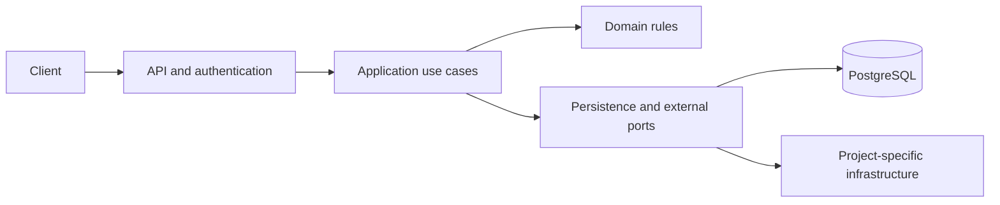

# LedgerAtlas — Backend Developer Track

**Project 8 of 8 · Independent capstone · requirements only; choose compatible supported dependencies**

> Start with [Getting Started](docs/GETTING_STARTED.md), then [Submission Rules](docs/SUBMISSION_RULES.md). The complete rules are below; milestone checklists point back here.

## 1. Overview

Build **LedgerAtlas**, a backend for **auditable transfers and regional disaster recovery**. You implement the application, data model, API and failure handling. The learning focus is: Architecture from scratch: double-entry ledger, event sourcing, CQRS, serializable transactions, durable workflow, fencing, consistency models, reconciliation, multi-region recovery.

This is original learning material organized like the supplied `substream.zip`: numbered specification, stable business-rule IDs, M1–M3 shared milestones, D4–D7 developer milestones, an AQA guide and reflection. It is not connected to the SubStream/NIX grading bot. The reference project is [SubStream](https://github.com/Abd-Elrahman3/SubStream-Developer-Track); no completed solutions or proprietary bot are included.

## 2. How the Challenge Works

### 2.1 Milestones

Do projects in order. Prerequisite: complete D7 of [VaultIndex](https://github.com/Abd-Elrahman3/07-vaultindex-spring-boot) and explain its failure drills.
Every milestone is required. Advanced requirements are part of completion, not optional stretch goals. M1–M3 establish the model, database and transactions; D4–D7 add contracts, difficult behavior, failure recovery and operation.

| Milestone | Goal | Branch | Guide |
| --- | --- | --- | --- |
| M1 | Domain and invariants | `feature/m1-domain` | [Shared](docs/SHARED_MILESTONES.md) |
| M2 | Database and persistence | `feature/m2-database` | [Shared](docs/SHARED_MILESTONES.md) |
| M3 | Transactional use cases | `feature/m3-transactions` | [Shared](docs/SHARED_MILESTONES.md) |
| D4 | API contracts and authorization | `feature/d4-api` | [Developer](docs/TRACK_DEVELOPER.md) |
| D5 | Advanced behavior and resource limits | `feature/d5-advanced` | [Developer](docs/TRACK_DEVELOPER.md) |
| D6 | Failure testing and recovery | `feature/d6-failures` | [Developer](docs/TRACK_DEVELOPER.md) |
| D7 | Operations and design defense | `feature/d7-operations` | [Developer](docs/TRACK_DEVELOPER.md) |

### 2.2 Levels

Bronze = M2; Silver = D4; Gold = D6; Platinum = D7 **with evidence**. Complete Platinum before progressing to the next project. A blocked feature should get a smaller reproducible experiment; do not mark it complete by removing its assertion.

### 2.3 How your work is evaluated

This repository intentionally contains only Markdown. You must create the build, implementation, tests and CI yourself. The acceptance specification and evidence checklist define completion; there is no preinstalled grader.

Automation is a guardrail, not proof of understanding. You own these repositories and can bypass local checks; keep the gates intact, review tests and explain tradeoffs aloud. There is no hidden evaluator and branch protection is not configured by these files.

## 3. Architecture



The API binds and validates transport input. The service establishes authorization and transaction boundaries. Domain objects enforce state rules. Persistence adapters map database data without leaking entities to API responses. Dependencies and clocks are constructor-injected. Keep network calls outside long database transactions and record uncertain outcomes explicitly.

See [Database Requirements](docs/DATABASE_REQUIREMENTS.md), [API Requirements](docs/API_REQUIREMENTS.md) and [Architecture Decisions](docs/ARCHITECTURE_DECISIONS.md) for this project's concrete boundaries.

### 3.1 How the classes relate

| Area | Responsibility |
| --- | --- |
| domain | Account, Transfer, Journal, DomainEvent |
| service | Use cases, transaction boundary and principal-derived identity |
| repository / persistence | Ports, SQL/JPA/R2DBC mappings, constraints and query strategy |
| api | DTOs, controllers/resolvers, validation and error mapping |
| advanced | Required project-specific workers, policies and adapters |
| config | Dependency injection, Clock, security, typed configuration |

## 4. Domain Model

| Type | Fields / types | Invariant |
| --- | --- | --- |
| Account | UUID id; String ownerSubject; String currency; AccountStatus status | ACTIVE or FROZEN; overdraft disallowed for customer accounts. |
| Transfer | UUID id; UUID sourceId; UUID destinationId; long amountMinor; String currency; String status | Positive minor-unit amount, same currency, stable idempotency identity. |
| Journal | UUID id; UUID transferId; Instant postedAt; List<Posting> postings | Immutable balanced postings per currency; corrections use reversing journals. |
| DomainEvent | UUID aggregateId; long aggregateVersion; UUID eventId; String type; String payload; Instant occurredAt | Append-only stream, unique aggregate version and event ID; deterministic replay. |

Fields are private. Do not add public state setters to bypass business methods. A rejected domain operation changes nothing. IDs are UUIDs unless explicitly stated otherwise. Identity equality uses persistent ID; value objects use their values. Store timestamps as UTC `Instant`; use `LocalDate` only for calendar-date rules. Nullability is explicit in database/API specs; unknown IDs are never treated as empty success. Use `ConflictException` for invalid state transitions and `IllegalArgumentException` for invalid domain values. Constructor signatures in starter examples are stable; you may add overloads, private fields and new classes as requirements grow.

No classes are supplied. Translate this model into code after documenting invariants and storage ownership; justify changes in an ADR.

## 5. Business Rules

Rule IDs are local to this repository. Each rule includes a concrete acceptance example. Full behavior, boundaries and failures matter; the examples are a starting test set.

### M1 — Domain and invariants

#### BR-101 — Balance every journal

Use integer minor units with overflow checks. Every journal balances signed postings to zero for each currency; transfer source differs from destination and amount>0. No floating point and no cross-currency transfer in scope.

**Acceptance example:** A 500-unit transfer produces -500/+500; mixed currency, zero, negative and overflow values fail unchanged.

#### BR-102 — Keep immutable history

Journal/posting rows cannot update/delete through application roles. Corrections append a reversal linked to the original and a new journal if needed. Frozen accounts reject new outgoing transfers but permit controlled reversals.

**Acceptance example:** Reversing twice is rejected by uniqueness; original journal and audit trail remain readable.


### M2 — Database and persistence

#### BR-201 — Commit atomically under contention

Within one writer region, transfer event,balanced journal,idempotency response and outbox commit together. Lock accounts by sorted ID or use SERIALIZABLE with bounded safe retries. Enforce no overdraft at the authoritative write boundary.

**Acceptance example:** 100 concurrent 100-unit transfers from balance 1,000 produce exactly 10 successes and no negative committed balance.

#### BR-202 — Enforce stream concurrency

Append events using expected aggregate version; unique(aggregate_id,aggregate_version) rejects concurrent stale writers. Store event schema version and upcasters. Snapshot is an optimization, never sole authority.

**Acceptance example:** Two writers with expected version 7 cannot both append version 8; rebuilding without a snapshot yields identical state.


### M3 — Transactional use cases

#### BR-301 — Implement idempotent commands

Transfer creation requires a key scoped to subject+operation for 30 days. Canonical payload mismatch returns 409. An uncertain HTTP outcome is resolved by replaying key or GET transfer. Never create a new key automatically on timeout.

**Acceptance example:** Crash after commit before HTTP response; retry returns the same transfer/journal and original status.

#### BR-302 — Separate CQRS read models

Build balance/history projections from committed events using durable consumer checkpoints. API returns projectionVersion/asOf. Read-your-writes uses a required minimum version, bounded wait 2s, then 202 with Retry-After.

**Acceptance example:** Pause projector: command remains durable while reads report lag; no stale projection authorizes a debit.


### D4 — API contracts and authorization

#### BR-401 — Secure transfer boundaries

OIDC JWT validates issuer/audience ledgeratlas-api; authorize account ownership and transfer scope. Require an additional authorization step for a configurable high-value threshold, modeled with a one-use short-lived approval token.

**Acceptance example:** IDOR, replayed approval and stale approval fail; failed attempts reveal no other user’s account balance.

#### BR-402 — Publish immutable events safely

Outbox feeds Kafka with key=account/transfer chosen in an ADR; consumers dedup eventId and tolerate redelivery. Explain cross-account ordering limits. Schema evolution is backward compatible and replay upcasts old records.

**Acceptance example:** A consumer restart processes duplicates without double-crediting the read model.


### D5 — Advanced behavior and resource limits

#### BR-501 — Reconcile ledger invariants

Daily reconciliation checks per-journal balance, transfer↔journal mapping, authoritative totals vs projections, and missing outbox events. Report discrepancies and quarantine affected operations; repairs require reviewed reversing entries.

**Acceptance example:** Seed one missing projection and one corrupt test fixture; reconciliation distinguishes rebuildable lag from authoritative inconsistency.

#### BR-502 — Rebuild and verify projections

Replay to shadow tables at a fixed high-water mark, catch up and compare hashes/counts before switch. Do not resend external side effects during replay. Handle deterministic clock-dependent logic using recorded event facts.

**Acceptance example:** Replay the same stream twice into empty stores yields equal balances and counts, including old schema versions.


### D6 — Failure testing and recovery

#### BR-601 — Prevent two regional writers

Use an active/passive model with one authoritative writer and a fencing epoch validated at writes. Document who grants epochs and how old writer credentials/leases are revoked. During uncertain ownership reject writes; DNS changes alone are insufficient.

**Acceptance example:** Partition regions, attempt promotion, and prove the old writer cannot commit after the new epoch; no split-brain balances.

#### BR-602 — Practice disaster recovery

Define RPO<=60s and RTO<=15m for the lab with asynchronous replication and backups. Identify accepted writes in the possible loss window; never promise zero data loss. Restore, reconcile and publish an explicit affected-transfer report.

**Acceptance example:** Kill writer region, promote only after fencing, measure recovery and enumerate any missing acknowledged transfers.


### D7 — Operations and design defense

#### BR-701 — Meet measurable service objectives

Target 99.95% command availability and p99 transfer commit <500ms at 100 transfers/s on documented hardware. Track serialization retries, projection lag, reconciliation failures and replica lag with bounded labels.

**Acceptance example:** Publish load report and error-budget policy; alerts distinguish dependency outage from invariant violation.

#### BR-702 — Defend every guarantee

Deliver consistency/availability tradeoff ADR, threat model, data-retention plan, incident timeline and recovery runbook. Explain database isolation, fencing, retries and eventual projections with concrete counterexamples.

**Acceptance example:** An independent reviewer can reproduce race, replay and regional-failure drills and verify journal balance from SQL alone.

## 6. Provided Infrastructure

Provided: this specification, milestone guides, API/database requirements, acceptance scenarios, operations exercises, primer reading guidance and reflection. No Java, SQL, build files, containers or CI are supplied.

External providers must be mocked locally. No real payments, messages to customers or paid cloud accounts are needed. Install only the components required for the current milestone. See setup instructions for versions and ports.

## 7. Project Structure

```text
README.md                     full model and business rules
REFLECTION.md                 evidence of understanding
docs/GETTING_STARTED.md        setup and first milestone
docs/SHARED_MILESTONES.md       M1–M3 checklists
docs/TRACK_DEVELOPER.md         D4–D7 checklists
docs/TRACK_AQA.md               mandatory complementary testing track
docs/SUBMISSION_RULES.md        branches, commits, completion rules
docs/DATABASE_REQUIREMENTS.md  schema, constraints, indexes, migrations
docs/API_REQUIREMENTS.md       transport, status, auth and payload rules
docs/ACCEPTANCE_TESTS.md        failure and boundary test matrix
docs/ADVANCED_BACKEND_GATES.md  non-optional completion evidence
docs/LEARNING_PATH.md           eight-project progression
docs/primers/                  short concept guides and official references
docs/aqa/                      API test guidance
docs/evidence/                 fill after reproducing each milestone

```

## 8. What Good Code Looks Like Here

Use clear transaction boundaries, immutable DTOs, constructor injection and small use cases. Never depend on H2 to prove PostgreSQL locking/constraints. Never log credentials. Tests assert durable state and externally observable behavior, not only mocked call counts. Keep request/broker buffers bounded and retries limited. Explain every index, retry and trust boundary you introduce. Record actual measurements instead of assuming a technology is faster.

This curriculum covers a broad backend progression; it does not claim to exhaust every Spring module. [Learning Path](docs/LEARNING_PATH.md) maps the concepts and identifies follow-on subjects.

See [Implementation Labs and Contract Details](docs/IMPLEMENTATION_LABS.md) for concrete fixtures, payload semantics and boundary experiments. These are required, not optional extras.
